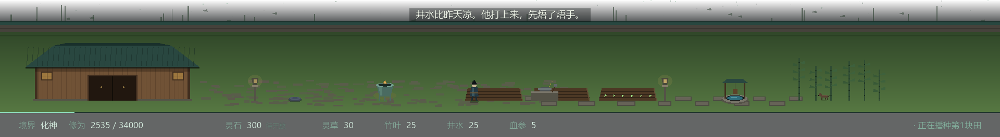
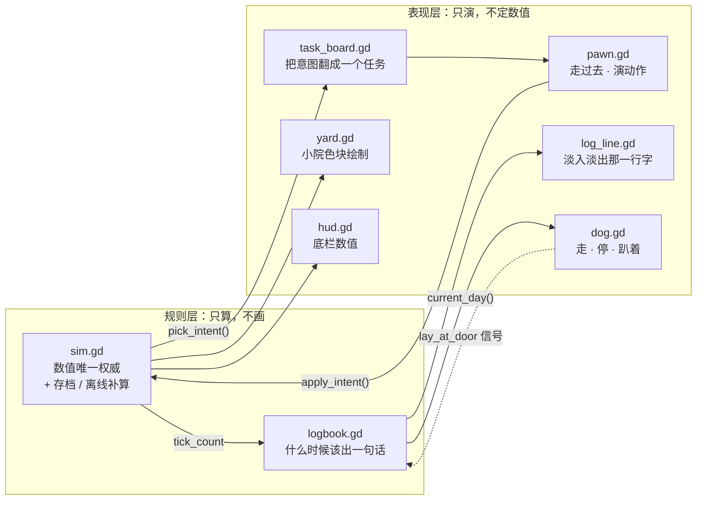

# 修仙小院 · xianxia-yard

> 一条挂在 Windows 桌面**最底部**的修仙小院。你忙你的，小人自己去种田、收获、炼丹、打坐，忙完再回来接着忙。



它是 264 像素高的一条窗口，贴在屏幕底边，**会被其他窗口正常盖住**——不是悬浮窗，不抢焦点，不进 Alt+Tab。
你不需要操作它，偶尔扫一眼，看它在干什么。

---

## 它是什么 / 不是什么

| 是 | 不是 |
|---|---|
| 一个窗口贴底、纯观赏的挂机模拟 | 一个需要你点来点去的游戏 |
| 小人自动做「收割 → 播种 → 采集 → 炼丹 → 打坐」 | 一个靠弹窗/推送提醒你的 App |
| 数值与叙事两条曲线并行推进 | 一个把奖励做成特效的东西 |
| 32 小时的完整曲线（练气 → 仙人） | 一个无限滚数值的放置游戏 |

---

## 现在跑到什么程度

| 项 | 状态 |
|---|---|
| 境界 | 9 段：练气 → 筑基 → 金丹 → 元婴 → 化神 → 炼虚 → 大乘 → 渡劫 → 仙人 |
| 内容 | 8 味丹方 / 4 种作物 / 3 块灵田（按境界解锁） |
| 通关时长 | **32.1 小时**（实测，≈ 第 304 个游戏日） |
| 叙事 | 57 条一次性日志 + 4 个循环事件（各 3 变体）+ 6 条事件型（已武装 4） |
| 院子 | 第 96 天钻进一条狗，第 900 天它就不在了 |
| 离线 | 关掉再打开会补算，并给一句「一觉醒来」小结 |
| 存档 | v3，v1 / v2 自动迁移 |

**没做的**：灵石消费（15 条升级项数据写好了、代码没接）、炼器（铁砧只有画面）、天气 / 燕子、飞升后的内容、日志第 2 批。详见 [`design/balance_schema.md`](design/balance_schema.md) 末尾的缺口表。

---

## 快速开始

需要 **Godot 4.7.x 标准版**（不是 .NET 版），Windows 10/11。

```bash
# 1) 用编辑器打开
godot --path . --editor

# 2) 直接跑（引擎会自己摆好贴底窗口）
godot --path .
```

想让窗口真正**压在 Z 序最底、不进任务栏**（Godot 只有"置顶"没有"置底"）：

```bash
# Windows，需要 Python 3
python tools/pin_bottom.py

# 或者双击
run.bat
```

脚本用 `ctypes` 调 user32 补上 `WS_EX_NOACTIVATE` / `WS_EX_TOOLWINDOW` / `HWND_BOTTOM`。
引擎路径按 `--godot=<路径>` → 环境变量 `XIANXIA_GODOT` → PATH → 桌面常见位置 的顺序查找。

---

## 架构



**一条铁律：数值只有一个权威。**
`sim.gd` 算「该做什么」，`pawn.gd` 只负责把这件事演出来，演完再把耗时交回去结算。
所以**离线补算和在线挂机走的是同一套判定**，不会出现「挂机一套、离线一套」。

**日志不存档。** 播到第几条由累计在线秒数现算，读档回退最多重播一条，永远不会卡住进度。

---

## 目录

```
scripts/          游戏代码（9 个文件，约 3000 行）
  sim.gd          数值层：境界 / 丹方 / 田块 / 采集 / 离线 / 存档      ← 唯一的数值权威
  logbook.gd      日志引擎：天数类 / 循环类 / 事件类三种触发
  yard.gd         小院绘制（全部 _draw() 色块，无外部图片）
  pawn.gd         小人：寻路 → 演动作 → 回来领活
  hud.gd          底栏
  dog.gd          狗
  task_board.gd   派活板（薄，只做翻译）
  log_line.gd     那行字
  main.gd         组装 + 窗口摆放
data/
  balance.json    所有数值（作物 / 丹方 / 境界 / 升级 / 采集）
  logs.json       所有文案（一次性 / 循环 / 事件）
design/           设计文档：数值口径、日志文案、美术方向
docs/             验收记录（每个里程碑一份，含实测数据与截图）
tools/            探针与工具脚本
```

---

## 三条探针

改完数值或日志，跑这三条就知道有没有把它弄坏：

```bash
GODOT="godot"          # 换成你的引擎路径

# 采集：九段境界逐段钉死，测采集次数与占比
"$GODOT" --headless --path . --script res://tools/probe_gather.gd

# 日志：快进 1400 天，查 57 条是否全触发、有无重播、循环排期
"$GODOT" --headless --path . --script res://tools/probe_log.gd

# 狗：天数阈值 + 15 分钟状态机 + 墙根事件
"$GODOT" --headless --path . --script res://tools/probe_dog.gd
```

验收记录在 [`docs/`](docs/)：`m2-accept.md`、`m3-log-accept.md`、`m3-dog-accept.md`。
每一条都写了"用什么方法测的、结果是多少"，包括踩过的坑。

---

## 三条设计原则

1. **宁可难看，不要好看。**
   顺滑的句子比难看的句子更可疑——顺滑往往意味着作者在替玩家完成情绪，而只给动作和物，才能让玩家自己疼。

2. **数值错玩家只看见变慢，文案错玩家看见有人在替他感动。**
   所以日志里不出现"获得 / 解锁 / 达成 / 恭喜 / 已收集"，也不出现"你"。

3. **院比人长寿。**
   他 306 天成仙，院子还在；狗陪了他 804 天，然后狗死了，他还活着。这是这个题材里最疼的地方，也是整条曲线的意义。

---

## 许可证

[MIT](LICENSE)
